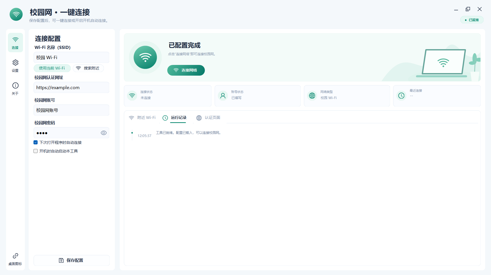

# 校园网一键连接

Windows 桌面小工具：双击图标，连接已保存的校园 Wi-Fi，用 WebView2 打开学校认证页并自动填写、提交账号密码，确认真的能上网后再报告成功。面向深澜 SRun 认证页；首次使用请在设置里填入你学校的实际认证地址，路径需与学校实际使用的一致（形如 `http://<认证服务器>/<认证路径>`，具体可向学校网络中心确认）。



## 功能

- **一键连接**：保存过 SSID 和账号后，双击桌面图标即可完成「连 Wi-Fi → 打开认证页 → 填写提交 → 确认联网」。
- **自动填写认证页**：真实的 WebView2 加载学校页面，识别深澜常见 ID、通用表单、同源 iframe；识别不了时可在高级设置里指定 CSS 选择器。
- **开机自动联网**：可选开机自启，启动后持续重试直到联网；遇到账号错误或需要人工操作会立刻停下。
- **过程可见**：运行记录时间线 + 四张状态卡片（连接状态、账号状态、网络类型、最近连接）。
- **无边框自绘界面**：圆角窗口、自绘控件、矢量图标，不依赖任何 UI 框架。
- **免管理员权限**：程序与安装包全程当前用户级，不弹 UAC，也不装服务或计划任务。

## 系统要求

| 项 | 要求 |
| --- | --- |
| 系统 | Windows 10 / 11，64 位 |
| 运行时 | .NET Framework 4.7.2 或更高（Win10 1803 以后自带） |
| 浏览器组件 | Microsoft Edge WebView2 Evergreen Runtime（Win11 自带；Win10 装过 Edge 一般已有） |
| 权限 | 普通用户即可，无需管理员 |

缺少 WebView2 时请从微软官网安装：<https://developer.microsoft.com/microsoft-edge/webview2/>

## 使用

### 首次使用

1. 先在 Windows 里手动连接一次校园 Wi-Fi 并保存（Wi-Fi 自身的密码由 Windows 管理，本工具不保存）。
2. 运行 `CampusConnect.exe`，填写 SSID、认证网址、校园网账号与密码，点「连接网络」。
3. 点左侧栏底部「桌面图标」创建快捷方式，以后双击它即可。

SSID 留空表示使用电脑当前网络，也适用于有线校园网。

### 日常使用

- 默认勾选「下次打开程序时自动连接」：双击图标即开始连接。
- 关掉该勾选后，打开程序只显示设置；也可用 `CampusConnect.exe --settings` 直接进入设置。
- 已能上网时不会重复提交认证；连接成功后窗口可以直接关闭。
- 修改配置后点「保存配置」，或直接点「连接网络」（保存并立即连接）。
- 「取消连接」只停止后续步骤，不会断开已连接的 Wi-Fi，也不会撤回已经提交的登录请求。
- 高级设置（Wi-Fi 配置名称、账号/密码/登录按钮的 CSS 选择器）只有一个入口：左侧栏的「设置」。

### 开机自动连接

勾选「开机时自动启动本工具」后，程序写入当前用户启动项：

```
HKCU\Software\Microsoft\Windows\CurrentVersion\Run   →   "<exe 路径>" --autostart
```

不需要管理员权限，也不添加服务或计划任务，取消勾选即删除该项。该选项默认关闭。

开机路径会**一直重试到联网**：失败后按 5、10、20、40、60 秒退避（之后固定每 60 秒一轮），状态栏显示「等待重试」和已持续时长，随时可点「取消连接」中止。两条硬性刹车避免变成死循环：

- **认证页明确报错**（密码错误、账号停机、欠费、请求过于频繁等）→ 立即停止并显示原文，重试只会加重学校侧的风控；
- **需要人工操作**（验证码、运营商选择、页面跳转）→ 立即停止，把认证页留给用户，避免反复刷新冲掉已填内容。

另设 30 分钟总上限：不在校园网范围内时（例如在家开机）不再无限拨号，到点停下并提示可手动重试。手动点「连接网络」始终只尝试一次，失败原因立刻可见。

启动项里记的是可执行文件的绝对路径，所以换版本目录或改用安装包后路径会过期。程序每次启动都会比对，已启用但路径与当前 exe 不一致时自动改写，升级后无需重新勾选。

## 认证页行为

- 认证页跑在 **InPrivate** 会话里，并禁用了密码自动保存、表单自动填充、开发者工具与右键菜单；关闭程序后不保留认证 Cookie。
- 自动填写**只在配置的同一来源**（协议 + 主机 + 端口全部相同）内执行。原生侧先校验一次，注入脚本里再用 `location.origin` 复查一次，防导航竞态；跨域 iframe 永远拿不到凭据。
- 每次连接流程**最多自动提交一次**账号密码，不会重复登录。
- 认证页加载完成后界面会自动切到「认证页面」标签，能直接看到填写与提交过程；联网成功后自动切回「运行记录」。
- 出现验证码、运营商选择或额外服务协议时会停在该页面等你操作，不会自动刷新。

## 数据与隐私

- 配置与账号：`%LOCALAPPDATA%\CampusConnect\settings.json`
- 密码用 Windows DPAPI（CurrentUser）加密后保存，不会写入日志；加密结果无法迁移给其他 Windows 用户。
- WebView2 的用户数据目录同在 `%LOCALAPPDATA%\CampusConnect`，与程序安装目录分离，因此重装或换安装位置都不会丢账号。
- 删除上述 `settings.json` 即可清除保存的账号密码（先关闭程序）。

## 构建

目标 Windows 10/11 x64，使用系统自带的 .NET Framework C# 编译器（`csc.exe`），**不需要 Visual Studio，也不需要 MSBuild**。

WebView2 SDK 固定为 `1.0.2903.40`，先下载并解压到 `vendor/webview2/`：

```powershell
curl.exe -L --fail https://api.nuget.org/v3-flatcontainer/microsoft.web.webview2/1.0.2903.40/microsoft.web.webview2.1.0.2903.40.nupkg -o webview2.nupkg
Add-Type -AssemblyName System.IO.Compression.FileSystem
[IO.Compression.ZipFile]::ExtractToDirectory("$PWD\webview2.nupkg", "$PWD\vendor\webview2")
```

然后按需运行：

| 脚本 | 作用 |
| --- | --- |
| `build.ps1` | 编译程序，运行核心测试与渲染测试 |
| `verify-ui.ps1` | 运行真实 WebView2 集成测试，并生成三种窗口尺寸的界面截图 |
| `package.ps1` | 生成 `release/校园网一键连接-v<版本>/` 与 zip |
| `make-installer.ps1` | 生成安装包 `release/校园网一键连接-<版本>-安装程序.exe` |
| `install.ps1` | 从发布目录创建桌面快捷方式并启动 |
| `update-ui.ps1` | 串起「打包 → 安装包 → 激活测试 → 快捷方式」 |
| `repair.ps1` | `build.ps1` + `update-ui.ps1` |
| `qa.ps1` | `build.ps1` + `verify-ui.ps1` |

```powershell
powershell -ExecutionPolicy Bypass -File .\qa.ps1
```

`verify-ui.ps1` 只用本地测试页面，不会连接 Wi-Fi，也不会访问真实认证页。

### 版本号

版本号只写在根目录的 [`VERSION`](VERSION) 一个文件里。`version.ps1` 供各脚本引入；`build.ps1` 据此生成 `artifacts/build/Version.g.cs` 供 C# 使用，程序标题、互斥体名、窗口标识、关于对话框都取自它。升级只改 `VERSION` 一处。

### 脚本编码（容易踩的坑）

**所有 `.ps1` 和 `installer.nsi` 必须以「UTF-8 带 BOM」保存。** Windows PowerShell 5.1 会把无 BOM 的 `.ps1` 按系统 ANSI 代码页解析，脚本里的中文路径会变成乱码（典型报错：`New-Item : Illegal characters in path`）。`build.ps1` 启动时会先检查 BOM，缺失就直接报错；`make-installer.ps1` 对 `.nsi` 做同样检查。

## 安装包

`make-installer.ps1` 调用 `vendor\nsis\makensis.exe` 编译 [`installer.nsi`](installer.nsi)，输出约 1.2 MB 的安装程序：

```powershell
powershell -ExecutionPolicy Bypass -File .\package.ps1
powershell -ExecutionPolicy Bypass -File .\make-installer.ps1
```

安装包行为：

- 装到 `%LOCALAPPDATA%\Programs\CampusConnect`，`RequestExecutionLevel user`，**全程不弹 UAC**；
- 创建开始菜单快捷方式，桌面快捷方式做成可勾选的组件；
- 注册卸载项，可在「设置 → 应用」中卸载；
- 安装前检查 WebView2 运行时（缺失时提示并可打开微软下载页）与 .NET Framework 4.7.2；
- 卸载时清理文件、快捷方式、**开机自启注册表项**、卸载项与 WebView2 缓存目录，并**询问**是否删除已保存的账号（静默卸载一律保留）。

`vendor/nsis/` 不纳入版本管理（`.gitignore` 忽略 `vendor/`）。若构建机无法直连 github.com 与 jrsoftware.org，可从 npm 镜像获取整份 NSIS 发行版（3.03，zlib/libpng 许可）：

```powershell
curl.exe -L --fail https://registry.npmmirror.com/@nsis-u/makensis/-/makensis-3.3.0.tgz -o nsis.tgz
tar -xzf nsis.tgz            # 解出 package\ 目录：makensis.exe、Bin、Contrib（含简体中文语言文件）
Move-Item .\package .\vendor\nsis
.\vendor\nsis\makensis.exe /VERSION
```

安装包不做代码签名，所以首次运行时可能出现 SmartScreen 提示，选择「更多信息 → 仍要运行」即可。

## 测试

| 测试 | 覆盖内容 | 规模 |
| --- | --- | --- |
| `tests/CoreTests.cs` | URL 与同源校验、DPAPI 加解密、原子写配置、参数转义、SSID 校验、重试退避策略 | 33 项 |
| `tests/RenderingTests.cs` | 圆角/胶囊按钮在 5 种状态、3 种尺寸下的重绘与残留像素 | 60 个状态 |
| `tests/BrowserTests.cs` | 真实 WebView2 中的认证页填写：特殊字符、事件触发、单次提交、验证码、错误识别、同源 iframe、跨域隔离、来源竞态 | 19 项 |
| `tests/ActivationTests.cs` | 单实例行为：隐藏窗口唤出、最小化还原、重复启动不弹多余对话框 | 3 项 |

## 源码结构

```
src/Core.cs          配置与 DPAPI 加密、校验、Wi-Fi（WLAN API + netsh）、网络检测、开机自启、重试策略
src/MainForm.cs      连接流程编排、WebView2 生命周期、重试循环、单实例窗口过程
src/MainForm.Ui.cs   布局、状态卡片、时间线日志、窗口按钮
src/Design.cs        自绘控件（圆角卡片、按钮、图标）、SVG 路径解析
src/portal.js        注入认证页的填写与状态识别脚本
tests/               上述四个测试
assets/icons/        矢量图标的路径数据
assets/app-icon.png  应用图标源图（构建时生成多尺寸 campus.ico）
installer.nsi        NSIS 安装包脚本
VERSION / version.ps1 版本号的唯一来源
```

## 图标与许可

- 界面图标全部来自 [Ant Design Icons](https://github.com/ant-design/ant-design-icons)（npm `@ant-design/icons-svg` 4.6.0），**MIT 许可**。清单与来源见 [`ICON-SOURCES.md`](ICON-SOURCES.md)。
- 第三方许可全文（Ant Design Icons 的 MIT 文本、Microsoft WebView2 SDK 的 BSD 声明、NSIS 说明）见 [`THIRD-PARTY-NOTICES.md`](THIRD-PARTY-NOTICES.md)，该文件随安装包与 zip 一起分发。
- 微软 WebView2 组件保留原始许可（分发目录中的 `WebView2-LICENSE.txt`）。
- 「Microsoft」「Edge」「WebView2」为微软公司商标；「深澜」「SRun」为其权利人商标，本文仅作事实性描述。
- **本仓库自身源码尚未附许可证文件**，在补充之前请视为保留所有权利（All rights reserved）。

## 已知限制

- **真实学校环境需自行验证**：本地测试覆盖不到校园路由、认证服务器可达性，以及各校定制过的认证页样式。
- **联网检测依赖外部站点**（微软联网检测页与 Google 的 204 页）。学校白名单、多网卡、VPN 都可能让检测失败，此状态只代表「当前这台电脑能否访问检测站点」。
- **「忘记网络」会失效**：本工具不保存 Wi-Fi 密码，`netsh wlan connect` 只能激活 Windows 里已有的配置文件。忘记网络会连保存的 WPA 密码一起删除，此时工具会立即报错提示先在系统里重新连一次，而不是无限重试。
- **圆角仅在 Windows 11 生效**：更旧的系统不支持 `DWMWA_WINDOW_CORNER_PREFERENCE`，窗口保持直角。
- **未提供最大化按钮**：仍可双击标题栏最大化/还原。
